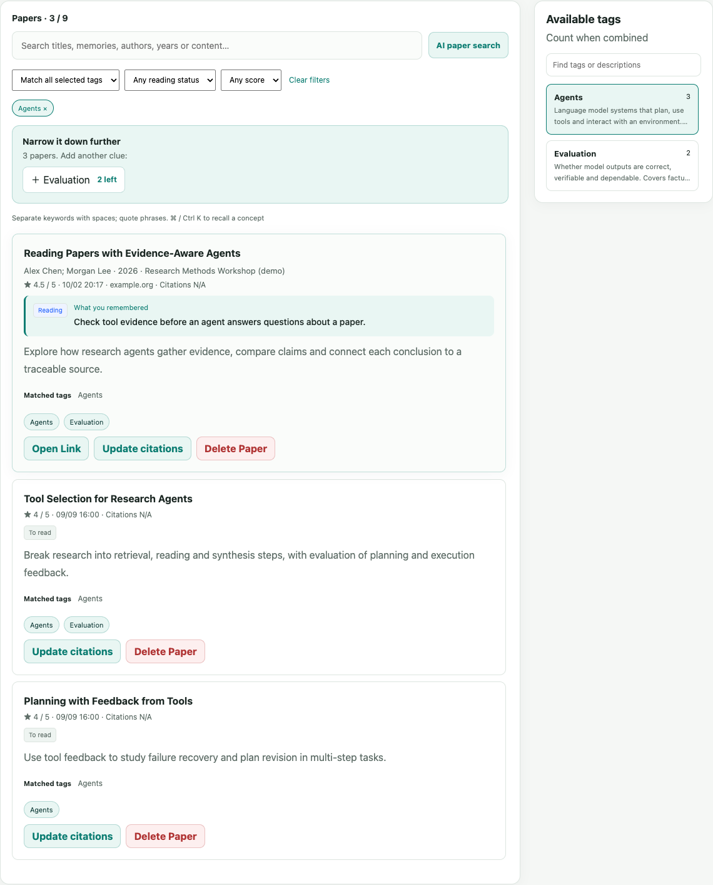

<div align="center">


<h1>Paper_Mind</h1>

<h3>Find your papers through the concepts you remember.</h3>

<p>A lightweight paper manager built around tags and personal memories, with local storage, progressive filtering, and optional LLM assistance.</p>

[](CHANGELOG.md)
[](extension/manifest.json)
[](LICENSE)

**English** · [简体中文](README_zh.md)

[Features](#features) · [Quick start](#quick-start) · [Workflow](#workflow) · [Model setup](#model-setup) · [Documentation](#documentation) · [Contributing](#development)

</div>

After reading a paper, its title and method can fade from memory. What remains might be **“something about agent optimization,” “perhaps the OPD algorithm,” or “maybe a paper from team XXX.”**

Paper_Mind captures different aspects of a paper with several tags, alongside one sentence in your own words. When you return, follow the clues you still remember: **rough concept → existing tags → narrower results → your paper**.

## Demo

English narration · **2:34** · Chinese and English subtitles. Play the video here to see the journey from saving a paper to finding it again.

https://github.com/user-attachments/assets/046375e1-bd08-4663-93ac-0858b0aeb835

[Download video](assets/videos/paper-mind-intro-en.mp4) · [Subtitles](assets/videos/paper-mind-intro-en.srt) · [Transcript](assets/videos/transcript.en.md)

## Features

| Feature | What you can do |
| --- | --- |
| **Paper capture and web clipping** | Save papers, blog posts and commentary with titles, abstracts, sources, authors, years and venues. Keep several supporting materials with one paper. |
| **Recall through concepts** | Search existing tag names, aliases and descriptions. Use optional AI matching when your memory is vague. |
| **Progressive filtering** | Select a tag, see suggestions with exact remaining counts, then combine tags, reading status and ratings to narrow the results. |
| **Personal memory** | Write a one-line memory while saving. See it alongside matching excerpts in search results to recognize the right paper. |
| **Meaningful tags** | Give each paper several tags, with no count limit. Reuse names and aliases, review merges, and generate AI descriptions from your tags and linked papers. |
| **Topic analysis within each tag** | Compare the design thinking of papers under one tag: a design matrix, design-space chart, design spectra and similarity heatmap show who is alike and where they diverge. Tick a few papers to compare them directly. Click to generate or update. |
| **Reading and discovery** | Track To read, Reading, Read and Revisit separately. Explore papers with shared tags, with optional AI abstract translation and content recommendations. |
| **Research topic packs** | Save inclusion and exclusion rules for a research direction. Newly saved papers appear when they match. |
| **Deep exploration** | Choose 2–4 tags: their design principles are distilled and fused into new ideas, with a fusion map showing which principles each idea borrows. Ask follow-up questions with source excerpts, and refine a selected idea through 1–3 automatic research rounds. |
| **Local data management** | Use English or Chinese, light or dark mode, JSON import/export and scheduled backups. Basic capture and search require no account. |

**Core workflows work without a model.** Optional AI supports concept matching, tag descriptions, topic analysis, semantic search, translation, content recommendations, tag-merge suggestions and Deep exploration.

## Quick start

### 1. Get the project

[Download the project ZIP](https://github.com/ZJU-OmniAI/Paper_Mind/archive/refs/heads/main.zip) and extract it, or clone the repository:

```bash
git clone https://github.com/ZJU-OmniAI/Paper_Mind.git
```

### 2. Load it in Chrome

1. Open `chrome://extensions` and enable **Developer mode**.
2. Click **Load unpacked** and select the project's **`extension/` folder**, which contains `manifest.json`.
3. Pin Paper_Mind to the browser toolbar.

**Loading the extension requires no build, npm dependencies or running server.** The local Claude Code / Codex bridge is optional; see [Model setup](#model-setup).

### 3. Save your first paper

Open a paper → click Paper_Mind → check its details → choose tags → add a memory sentence → **Save to library**. Click **Open** in the popup to browse and search your library.

To update an existing installation, update the local project files, click **Reload** for Paper_Mind in `chrome://extensions`, and reopen the manager. Restart the bridge too if you use a local CLI backend.

## Workflow

### Save clues you can return to

1. **Check the paper's details.** Review its title, abstract, authors, year and venue. Fill gaps manually or look up missing details for an existing record.
2. **Describe it with several tags.** A research direction, method and team can each be a tag. Reuse existing names and read their descriptions.
3. **Write one sentence in your own words.** For example: “Check tool evidence before an agent answers questions about a paper.” Set the reading status to Reading separately.

**One paper can have many tags; one tag can link to many papers.** Tags describe the content, while a separate field tracks reading progress. You can also save without tags and organize the paper later from Unsorted.

### Find it again, one clue at a time

| Step | Action | Result |
| --- | --- | --- |
| Recall a concept | Enter “agent optimization” in **What do you remember?** | Find existing tags with their descriptions and paper counts. |
| Follow one tag | Open its linked papers | See a related group and suggestions for narrowing it further. |
| Add another clue | Add Evaluation and choose match-all | Keep papers that match both tags. |
| Recognize your understanding | Read the memory sentence, matching excerpts and saved notes | Recover the paper and your reason for saving it. |



`Cmd / Ctrl K` focuses search. Full-text search supports space-separated keywords and quoted phrases. Searching never creates new tags.

**[Follow the screenshot walkthrough →](docs/walkthrough.en.md)** Eight steps take the same paper from capture to rediscovery. The [detailed feature guide](docs/features.zh-CN.md) covers clipping, tags, publication details and topic packs in Chinese.

> Videos and screenshots use the actual interface with an isolated sample library. Paper details, notes and AI output are demonstration content.

### Understand a research topic through its papers

Open **Tags → a tag → Topic analysis** and click **Generate topic analysis**. At least two papers need saved material to start. The assistant first extracts a method profile for each directly tagged paper, then synthesizes an overview, commonalities, differences and tradeoffs, research inspirations, a reading path and open questions. Profiles retain source excerpts and distinguish paper claims from your personal understanding. Inspirations are hypotheses with proposed validation steps, not verified discoveries.

The report has five views. **Overview** states the key takeaway, places each paper on two macro design axes in a **design-space chart** (closer papers think more alike), shows every axis as a **design spectrum**, and marks what all papers share in a **shared-foundation matrix**. **Design matrix** gives one row per paper and one column per design question; the same colour in a column means the same choice. Rows are ordered by design similarity, with a similarity heatmap, the most alike and most different pairs, and each dimension’s approach map. **Compare papers** is described below, **Methods** shows each paper’s block diagram and **Ideas** shows hypothesis-to-test diagrams. Axis positions are relative readings of saved material (−2 to +2); each needs evidence from that paper and none is a score or ranking. Full explanations, note interpretations and evidence remain expandable. Structural connections do not imply chronology, causality or ranking; flow arrows require supporting saved evidence. Existing reports open without a model request; older reports gain the new charts through **Generate design charts**, a single synthesis step that reuses saved profiles.

**Compare papers**: tick 2–8 papers of the tag in the matrix, the charts or the comparison picker, optionally state a focus, and choose **Compare**. The complete saved material of those papers is read to produce a one-line design stance per paper, a comparison table whose identical choices share a colour (marked as same or all different), design spectra and follow-up questions. Comparisons are kept with the tag, download as Markdown and travel with JSON backups.

Analysis reads each paper’s complete saved abstract, personal notes, memory sentence and every clip’s Markdown, without character-based source truncation. It uses the saved abstract translation only when the original is empty, and gives particular attention to your notes. Adding or editing papers, or removing them from the tag, marks the report as no longer covering the current material; those changes do not start a model request. Click **Update analysis** to refresh new or changed profiles and regenerate the synthesis, excluding removed papers. Unchanged profiles are reused. Once you start a task, its steps continue in the background and save progress. Further source changes require another update click to continue. Failed requests preserve completed work and the previous analysis so a manual retry can continue.

Topic analysis starts only when you click to generate, update, retry or reanalyze. Opening a tag or saving papers does not start it, and there is no automatic topic-analysis switch. It retains the tag’s last successful backend, model and effort. On first use it inherits an existing successful model choice for that tag, or current settings. Unavailable models produce an error; full reanalysis and an explicit switch to current model settings are available. Results and cached profiles stay local and travel with JSON backups. Model context limits still apply.

### Fuse design principles across tags for new ideas

Open **Deep exploration** in the manager after configuring a model and choose 2–4 tags to fuse. A balanced sample of at most eight distinct papers is shown and can be adjusted. The assistant distills 2–3 evidence-backed design principles per tag, then combines principles from different tags into testable ideas. A **fusion map** links each tag’s principles to the ideas, and each idea card shows “principle from A + principle from B → new idea” with how they combine. Tags with a saved topic analysis also send its summary as background, never as evidence. Continue discussing the analysis in the same chat. Answers include source excerpts and suggested follow-up questions. Each report supports up to 20 follow-up exchanges; failures can be retried without losing saved conversation history. To compare papers within one tag, use that tag’s **Compare papers**; earlier comparisons that fit no single tag stay readable under earlier comparisons in the session list.

Select a generated idea to run 1–3 consecutive rounds of critique, revision and experiment design. The budget of three automatic research rounds is separate from the 20 follow-up exchanges.

The chat shows the selected source papers before you start. New explorations send each selected paper’s complete saved text, including abstracts and translations, personal notes and every clip’s Markdown, plus saved paper information, tags and link previews, without character-based truncation. Links are not automatically opened. Follow-ups reuse that saved source snapshot; start a new exploration to include updates or replace an older excerpted snapshot. If the material exceeds the chosen model’s context capacity, the request fails visibly instead of silently cutting source text. Reports, conversation history and source excerpts are saved locally, travel with JSON backups and can be downloaded as Markdown. This first version analyzes saved library text: it does not search the web or run experiments, and generated hypotheses still need verification.

## Model setup

Choose a backend in **Manager → Model settings**:

| Backend | What you need | Bridge required? |
| --- | --- | --- |
| **Claude Code / Codex** | Node.js (22 or newer recommended) and the corresponding installed, signed-in CLI | Yes; macOS supports background autostart; other systems can run it manually |
| **Model service API** | Configuration for Qwen, Zhipu GLM, Kimi Code, DeepSeek, or another Chat Completions-compatible service | No |
| **Local model API** | A running local service with a Chat Completions-compatible endpoint | No |

### Local Claude Code / Codex

1. Sign in to your chosen CLI with `claude auth login` or `codex login`.
2. From the **Paper_Mind repository root**, macOS users can install autostart once:

   ```bash
   npm run bridge:install
   npm run bridge:token
   ```

3. Enter `http://127.0.0.1:39321` and the displayed token in model settings. Click **Check local connection**. Existing tokens remain valid.
4. Select the **model** and **reasoning effort**, save the settings, then click **Test model**.

Sign-in and pairing are usually one-time steps. On macOS, the service starts at login and restarts after exit, with no open terminal needed. Use `npm run bridge:status` to check it, or `npm run bridge:uninstall` to disable autostart. After updating bridge code, run `npm run bridge:install` again to refresh the background copy. Stop any manually started bridge before installation.

For Windows / Linux or a temporary session, run `npm run bridge`, keep the terminal open, and use `Ctrl+C` to stop it. Copy the URL and token from its output. Basic capture and local search remain available without the bridge.

### API or local model service

Select a provider or **Compatible API**, enter the base URL, model ID and any required API key, then save and test. Local services without authentication may leave the key empty. Custom endpoints must support **Chat Completions**. JSON mode is off by default.

**[Configuration and troubleshooting →](docs/local-models.md#english-quick-start)** The model guide includes an English quick start; detailed diagnostics and configuration tables are primarily in Chinese.

## Data and privacy

- **Your library stays on your machine.** Papers, tags, memory sentences, reading progress, topic analyses and research reports live in the extension's IndexedDB. Model settings use browser local storage.
- **Export your backups.** JSON import/export is at the bottom of model settings. Automatic backups are scheduled for 4 PM and require Chrome to be running. API keys and bridge tokens are excluded.
- **Keep clipped images with your archive.** Images are saved under Chrome's downloads directory. JSON stores their paths, not their bytes. Preserve the image folders when moving your library; enable **Allow access to file URLs** to display local images.
- **AI sends relevant text to your chosen service.** After configuration, tag descriptions, abstract translation and related-paper recommendations may run in the background. Topic analysis requires a click to start; it sends complete abstracts, personal notes, memories and clip Markdown for paper profiles, then synthesizes saved profiles. A local CLI can still call a remote model. Automatic tag descriptions can be disabled in Settings.
- **Research runs start when you request them.** Paper comparisons, cross-tag fusion, chat follow-ups and automatic research send the displayed source selection and its complete saved text, plus your question and relevant earlier analysis or conversation; fusion also sends the saved topic-analysis summaries of the chosen tags. Opening the chat or an existing report does not start a model request.

See the [privacy policy](PRIVACY.md) for details.

## FAQ

<details>
<summary><strong>Can I use it without a model account or API key?</strong></summary>

Yes. Capture, clipping, tag management, local search, combined filters, reading states, topic packs and JSON backups work immediately. Configure a model when you want the associated AI features.

</details>

<details>
<summary><strong>How do I keep tags manageable?</strong></summary>

There is no tag-count cap. Search names, aliases and descriptions before adding a tag, and reuse existing concepts. Review merge suggestions to consolidate synonyms. AI search only matches existing tags; it does not create tags for each query.

</details>

<details>
<summary><strong>Why are an author, year or venue missing?</strong></summary>

Some pages lack complete academic metadata. Edit the fields manually, or use **Fill missing details** in the paper's edit view to query Semantic Scholar / Crossref. Lookups fill empty fields for review before saving. Missing facts are not invented by an LLM.

</details>

<details>
<summary><strong>Why do citation counts differ from Google Scholar?</strong></summary>

Counts come from **Semantic Scholar**, not a combined total across databases. Coverage differs between providers, as its [official explanation](https://webflow.semanticscholar.org/faq/estimated-citations) notes. Click the citation source on a paper card to inspect the matched record; the detail view shows its title and when the count was retrieved.

Matching prefers an arXiv ID / DOI from the paper's source and checks the title. Title search accepts only normalized exact, unambiguous matches, using supplied authors and year to disambiguate. A higher count never determines the match, and arbitrary reference links in notes are not treated as the paper's source. Zero citations, missing records, uncertain matches and failed refreshes have distinct states. A failed refresh retains a previously verified count with a warning. Old cached counts are rechecked after upgrading; **Refresh all citations** also triggers a new lookup.

</details>

## Documentation

| Document | Contents |
| --- | --- |
| [Screenshot walkthrough](docs/walkthrough.en.md) | Save your first paper and find it through tags |
| [Feature reference — Chinese](docs/features.zh-CN.md) | Clipping, tags, topic packs, publication details and data management |
| [Model guide](docs/local-models.md#english-quick-start) | Local CLI and API setup; English quick start with detailed Chinese reference |
| [Changelog](CHANGELOG.md) | Changes by version |
| [Contributing](CONTRIBUTING.md) | Code layout, development conventions and validation |
| [Videos and assets](assets/videos/README.md) | Transcripts, subtitles and production notes |

## Development

Paper_Mind consists of a Chrome MV3 extension written in native JavaScript / ES modules and an optional Node.js bridge. Application code lives in `extension/`, the bridge in `bridge/`, and tests in `tests/`.

```bash
npm ci
npm test
npx playwright install chromium
npm run test:ui
npm run package:extension
```

The package is written to `dist/Paper_Mind-extension.zip`. With Chrome installed, use `PW_CHANNEL=chrome npm run test:ui` for browser tests. Reload the extension after editing to see your changes.

[Issues](https://github.com/ZJU-OmniAI/Paper_Mind/issues) and pull requests are welcome. Read the [contributing guide](CONTRIBUTING.md) before getting started.

## License

[Apache License 2.0](LICENSE).
